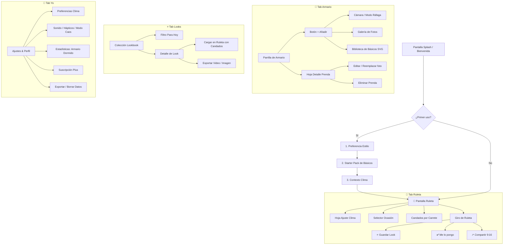
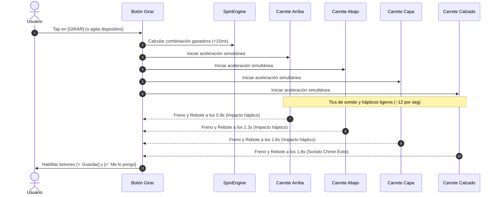
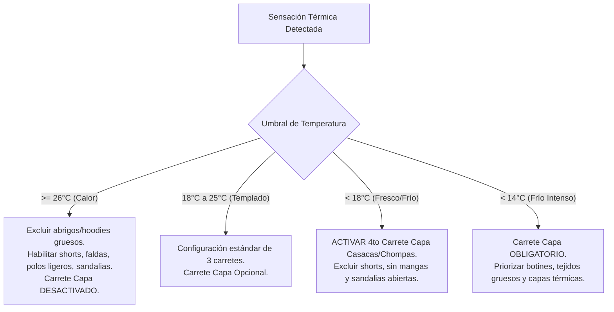
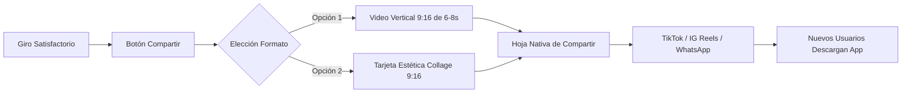
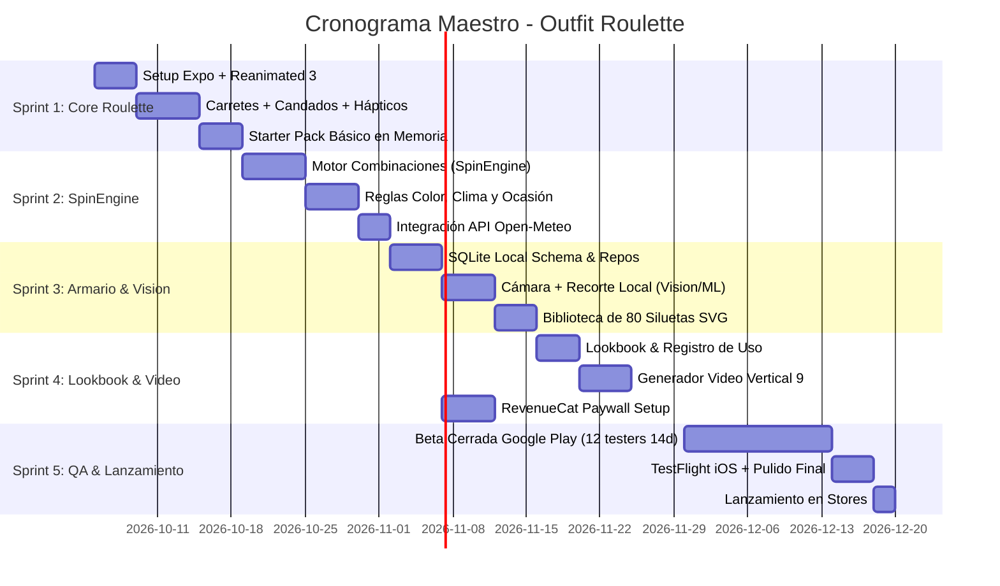

# Outfit Roulette — Master Product, UX & Technical Specification
## Documento Maestro Unificado (v1.0 Definitiva)
> **"Gira. Bloquea. Vístete."**  
> La ruleta interactiva que decide tu outfit diario en menos de 5 segundos usando tu propia ropa y adaptada al clima de hoy.

---

## Índice General
1. [Resumen Ejecutivo, Visión y Posicionamiento](#1-resumen-ejecutivo-visión-y-posicionamiento)
2. [Público Objetivo, Personas y Casos de Uso](#2-público-objetivo-personas-y-casos-de-uso)
3. [Principios Rectores de Producto](#3-principios-rectores-de-producto)
4. [Arquitectura de Navegación y Mapa de Pantallas](#4-arquitectura-de-navegación-y-mapa-de-pantallas)
5. [Wireframes Detallados de la Experiencia (ASCII)](#5-wireframes-detallados-de-la-experiencia-ascii)
6. [La Ruleta (Hero Screen, Físicas y Coreografía)](#6-la-ruleta-hero-screen-físicas-y-coreografía)
7. [Mecánica del Candado (Lock 🔒) y Gestos Táctiles](#7-mecánica-del-candado-lock--y-gestos-táctiles)
8. [Filtros de Ocasión y Clima Inteligente](#8-filtros-de-ocasión-y-clima-inteligente)
9. [Cero "Setup Tax": Onboarding en 90 Segundos](#9-cero-setup-tax-onboarding-en-90-segundos)
10. [Biblioteca de Básicos Vectoriales (80 Siluetas SVG)](#10-biblioteca-de-básicos-vectoriales-80-siluetas-svg)
11. [Armario, Cámara y Recorte Local (On-Device)](#11-armario-cámara-y-recorte-local-on-device)
12. [Lookbook ("Mis Looks") e Historial de Uso](#12-lookbook-mis-looks-e-historial-de-uso)
13. [El Motor de Combinaciones (SpinEngine) — Algoritmo Completo](#13-el-motor-de-combinaciones-spinengine--algoritmo-completo)
14. [Motor de Viralidad: Compartir y Video 9:16](#14-motor-de-viralidad-compartir-y-video-916)
15. [Sistema de Diseño Completo ("Boutique Arcade")](#15-sistema-de-diseño-completo-boutique-arcade)
16. [Arquitectura Técnica e Implementación (React Native + Expo)](#16-arquitectura-técnica-e-implementación-react-native--expo)
17. [Modelo de Datos Local Relacional (SQLite)](#17-modelo-de-datos-local-relacional-sqlite)
18. [Monetización, Modelo Freemium y RevenueCat](#18-monetización-modelo-freemium-y-revenuecat)
19. [Diccionario Regional de Vocabulario (LATAM y España)](#19-diccionario-regional-de-vocabulario-latam-y-españa)
20. [Historias de Usuario con Criterios de Aceptación (Gherkin)](#20-historias-de-usuario-con-criterios-de-aceptación-gherkin)
21. [Diccionario Completo de Microcopy y Textos de UI](#21-diccionario-completo-de-microcopy-y-textos-de-ui)
22. [Requisitos de Tiendas, Legalidad y Privacidad](#22-requisitos-de-tiendas-legalidad-y-privacidad)
23. [Matriz de QA, Testing y Casos Límite (50+ Casos)](#23-matriz-de-qa-testing-y-casos-límite-50-casos)
24. [Optimización para Tiendas (ASO) y Material de Lanzamiento](#24-optimización-para-tiendas-aso-y-material-de-lanzamiento)
25. [Roadmap Detallado de Ejecución por Sprints](#25-roadmap-detallado-de-ejecución-por-sprints)

---

## 1. Resumen Ejecutivo, Visión y Posicionamiento

### 1.1 El Problema Cotidiano
Decidir qué ponerse cada mañana es una micro-fatiga cotidiana que consume entre 10 y 25 minutos. A pesar de contar con armarios repletos de ropa, las personas sufren el sesgo del *"armario dormido"*: terminan usando el 20% de sus prendas de manera repetitiva y olvidan el 80% restante de combinaciones posibles.

### 1.2 Por Qué Fracasan las Apps Existentes (The Setup Tax)
Las aplicaciones actuales en el mercado (*Whering*, *Acloset*, *Stylebook*, *Cladwell*) adolecen de graves problemas estructurales:
1. **El impuesto de entrada:** Obligan al usuario a catalogar su ropa prenda por prenda, rellenando formularios burocráticos (marca, tela, precio, temporada, cuidado, talla). El 80% de los usuarios abandona antes de terminar de registrar 5 prendas.
2. **Lentitud y saturación de funciones:** Se han convertido en redes sociales lentas, con feeds, tiendas integradas y calculadoras de huella de carbono que vuelven la experiencia pesada.
3. **Muros de pago agresivos:** Limitan el armario a 100 prendas y exigen suscripciones costosas en dólares para funciones básicas.

### 1.3 La Solución: Outfit Roulette
Outfit Roulette invierte la lógica: **es un juego antes que un organizador**.
- **Entrada instantánea en 90 segundos:** Comienza a girar con un Starter Pack de básicos vectoriales sin tomar una sola foto si no se desea.
- **La ruleta tragamonedas:** 3 carretes base + 1 carrete dinámico de abrigo que giran con física satisfactoria en menos de 1.8 segundos.
- **El Candado (Lock 🔒):** Permite fijar prendas ("hoy quiero usar sí o sí mis zapatillas blancas") mientras la ruleta busca combinaciones para el resto.
- **Adaptación climática y de ocasión en 1 toque:** Descarta prendas incoherentes ante el frío (< 18°C) o según el plan (Clases, Cita, Fiesta, Gym).
- **Local-First & Privacidad Total:** Fotos y datos almacenados 100% en el dispositivo del usuario. Sin cuenta obligatoria y \$0 costo de servidores.

### 1.4 Propiedad Intelectual y Reglas de Cumplimiento
- **Inspiración:** La cultura pop de los 90s y el armario computarizado de *Clueless*.
- **Restricción legal estricta:** Queda estrictamente prohibido utilizar el nombre, marcas registradas, capturas de pantalla, audio, música, personajes o tipografías protegidas de la película de Paramount o de marcas comerciales de ropa (Nike, Zara, Adidas, etc.).
- **Identidad propia:** La estética se define como **"Boutique Arcade"** (minimalista, vibrante, limpia y con personalidad retro-moderna).

---

## 2. Público Objetivo, Personas y Casos de Uso

### 2.1 Demografía y Mercado
- **Edad núcleo:** 16 a 28 años (estudiantes secundarios, universitarios, practicantes y jóvenes profesionales).
- **Mercado geográfico inicial:** Perú $\rightarrow$ Latinoamérica hispanohablante (México, Colombia, Argentina, Chile) $\rightarrow$ España.
- **Plataformas de hardware:** Android de gama media y baja (predominante en LATAM, 3-4 GB RAM) e iOS. El rendimiento a 60 FPS es un requisito de ingeniería, no un añadido.
- **Canales de atención:** Usuarios intensivos de TikTok, Instagram Reels, Pinterest y WhatsApp.

### 2.2 Arquetipos de Usuario (User Personas)

| Persona | Contexto | Dolor Principal | Lo que Outfit Roulette le Resuelve |
| :--- | :--- | :--- | :--- |
| **Valeria, 19**<br>*Estudiante universitaria (Lima)* | Se despierta 7:15 AM con clases a las 8:00 AM. Clima húmedo y variable. | Pierde 15 minutos probándose 4 cosas frente al espejo y termina yendo siempre con el mismo buzo negro. | Abre la app, la ruleta detecta 16°C, gira y le da un outfit con hoodie y zapatillas en 3 segundos. |
| **Diego, 24**<br>*Practicante de diseño (CDMX)* | Armario con básicos, ropa vintage y pocas zapatillas de marca. | Quiere verse bien sin repetir combinaciones ni gastar dinero en ropa nueva. | Usa el candado en sus zapatillas favoritas y la app le descubre combinaciones con prendas que tenía olvidadas al fondo del ropero. |
| **Camila, 22**<br>*Creadora de contenido (Medellín)* | Graba contenido diario de lifestyle, moda urbana y vlogs. | Necesita formatos interactivos para conectar con su audiencia en redes. | Graba la pantalla de la ruleta girando para el reto *"La ruleta decide mi outfit de hoy"* y exporta el video 9:16 en 1 clic. |

### 2.3 Trabajos por Hacer (Jobs to be Done)
1. *"Ayúdame a salir vestido de mi casa en 2 minutos sin quemar energía mental."*
2. *"Hoy quiero ponerme esta prenda específica; encuentra tú con qué combina."*
3. *"Evita que pase frío o calor sin tener que consultar 3 páginas de pronóstico."*
4. *"Guarda lo que ya me probé y sé que me queda increíble para cuando tenga prisa."*
5. *"Permíteme compartir mi look de forma estética y divertida en mis redes sociales."*

---

## 3. Principios Rectores de Producto

1. **Fast First (Velocidad Absoluta):** Ninguna acción primordial puede requerir más de 2 toques. La animación del giro dura $\le 1.8$ segundos.
2. **Jugar antes que organizar:** Si una pantalla se parece a llenar una hoja de Excel, se rediseña o se elimina.
3. **Local-First & Offline Total:** El usuario es dueño de sus fotos. Todo se procesa y guarda en SQLite y almacenamiento local. Funciona perfecto en modo avión o en el metro.
4. **Respeto a la realidad física:** Las combinaciones deben ser utilizables. Si la app propone bermudas con 12°C o tacones en el gym, pierde credibilidad para siempre.
5. **Viralidad embebida:** La generación de contenido vertical para redes sociales está integrada en el flujo diario.

---

## 4. Arquitectura de Navegación y Mapa de Pantallas

La navegación se estructura en **4 pestañas inferiores fijas (One-Thumb Ergonomics)**:

```
┌────────────────────────────────────────────────────────┐
│   [ 🎰 Ruleta ]   [ 👕 Armario ]   [ ⭐ Looks ]   [ 👤 Yo ]   │
└────────────────────────────────────────────────────────┘
```



---

## 5. Wireframes Detallados de la Experiencia (ASCII)

### 5.1 Pantalla Principal — La Ruleta (Hero Screen)

```text
┌──────────────────────────────────────────────────┐
│  Hola, Vale                    ☀ 16° Lima   ⚙   │  ← Header + Clima interactivo
│                                                  │
│  [ Todo ]  [ Clases ]  [ Salida ]  [ Fiesta ]    │  ← Chips de Ocasión (un toque)
│                                                  │
│ ┌──────────────────────────────────────────┐ 🔓  │
│ │  ░░░░░░░░░░░░░░░░░░░░░░░░░░░░░░░░░░░░░  │      │
│ │         [ HOODIE OVERSIZE GRIS ]         │     │  Carrete 1: Superior (Rosa pastel)
│ │  ░░░░░░░░░░░░░░░░░░░░░░░░░░░░░░░░░░░░░  │      │
│ └──────────────────────────────────────────┘      │
│ ┌──────────────────────────────────────────┐ 🔒  │
│ │                                          │      │
│ │         [ PANTALÓN CARGO NEGRO ]         │     │  Carrete 2: Inferior (Azul pastel)
│ │                                          │      │  (BLOQUEADO con candado amarillo)
│ └──────────────────────────────────────────┘      │
│ ┌──────────────────────────────────────────┐ 🔓  │
│ │                                          │      │
│ │          [ CASACA BOMBER VERDE ]         │     │  Carrete 3: Capa (Menta pastel)
│ │                                          │      │  (Activo automáticamente por < 18°C)
│ └──────────────────────────────────────────┘      │
│ ┌──────────────────────────────────────────┐ 🔓  │
│ │  ░░░░░░░░░░░░░░░░░░░░░░░░░░░░░░░░░░░░░  │      │
│ │          [ ZAPATILLAS BLANCAS ]          │     │  Carrete 4: Calzado (Amarillo pastel)
│ │  ░░░░░░░░░░░░░░░░░░░░░░░░░░░░░░░░░░░░░  │      │
│ └──────────────────────────────────────────┘      │
│                                                  │
│    ⭐ Guardar       ✅ Me lo pongo       ↩   ↗   │  ← Acciones secundarias + Deshacer
│                                                  │
│ ┌──────────────────────────────────────────────┐ │
│ │                  🎰  GIRAR                   │ │  ← Botón Chicle 56dp (Zona pulgar)
│ └──────────────────────────────────────────────┘ │
│                                                  │
│   [🎰 Ruleta]    [👕 Armario]   [⭐ Looks]  [👤 Yo]   │  ← Barra de navegación inferior
└──────────────────────────────────────────────────┘
```

### 5.2 Pantalla de Onboarding — Selección de Básicos Iniciales

```text
┌──────────────────────────────────────────────────┐
│  OUTFIT ROULETTE                        Paso 2/3 │
│                                                  │
│  Arma tu armario inicial                         │
│  Toca las prendas que tienes en tu ropero.       │
│                                                  │
│  Llevas: 6 de 9 recomendadas                     │
│                                                  │
│  SUPERIOR                                        │
│  ┌──────────┐  ┌──────────┐  ┌──────────┐        │
│  │    [✓]   │  │    [✓]   │  │    [ ]   │        │
│  │   POLO   │  │   POLO   │  │  HOODIE  │        │
│  │  BLANCO  │  │   NEGRO  │  │   GRIS   │        │
│  └──────────┘  └──────────┘  └──────────┘        │
│                                                  │
│  INFERIOR                                        │
│  ┌──────────┐  ┌──────────┐  ┌──────────┐        │
│  │    [✓]   │  │    [✓]   │  │    [ ]   │        │
│  │   JEAN   │  │   CARGO  │  │  JOGGER  │        │
│  │   AZUL   │  │   NEGRO  │  │   GRIS   │        │
│  └──────────┘  └──────────┘  └──────────┘        │
│                                                  │
│  CALZADO                                         │
│  ┌──────────┐  ┌──────────┐  ┌──────────┐        │
│  │    [✓]   │  │    [✓]   │  │    [ ]   │        │
│  │  ZAPAS   │  │   BOTAS  │  │  CONVERSE│        │
│  │ BLANCAS  │  │  NEGRAS  │  │  NEGRAS  │        │
│  └──────────┘  └──────────┘  └──────────┘        │
│                                                  │
│ ┌──────────────────────────────────────────────┐ │
│ │             ¡Listo, a girar! (6)             │ │  ← Habilitado con >= 1 prenda/carrete
│ └──────────────────────────────────────────────┘ │
└──────────────────────────────────────────────────┘
```

### 5.3 Pantalla de Armario — Vista de Cuadrícula

```text
┌──────────────────────────────────────────────────┐
│  Mi Armario (24 prendas)                     🔍  │
│                                                  │
│  [Todo]  [Arriba]  [Abajo]  [Calzado]  [Capas]   │
│                                                  │
│  ┌────────────┐  ┌────────────┐  ┌────────────┐  │
│  │            │  │            │  │            │  │
│  │   PRENDA   │  │   PRENDA   │  │   PRENDA   │  │
│  │  RECORTADA │  │  RECORTADA │  │  RECORTADA │  │
│  │            │  │            │  │            │  │
│  │ Polo Overs.│  │ Jean Ancho │  │ Zapas Retro│  │
│  └────────────┘  └────────────┘  └────────────┘  │
│  ┌────────────┐  ┌────────────┐  ┌────────────┐  │
│  │            │  │            │  │            │  │
│  │   PRENDA   │  │   PRENDA   │  │   PRENDA   │  │
│  │  RECORTADA │  │  RECORTADA │  │  RECORTADA │  │
│  │            │  │            │  │            │  │
│  │ Bomber Kaki│  │ Cargo Beige│  │ Botas Cuero│  │
│  └────────────┘  └────────────┘  └────────────┘  │
│                                                  │
│                                      ┌────────┐  │
│                                      │  (＋)  │  │  ← Botón flotante flotante
│                                      └────────┘  │
│   [🎰 Ruleta]    [👕 Armario]   [⭐ Looks]  [👤 Yo]   │
└──────────────────────────────────────────────────┘
```

### 5.4 Ficha Detalle de Prenda (Hoja Inferior / Bottom Sheet)

```text
┌──────────────────────────────────────────────────┐
│                    ───                           │  ← Manija de arrastre
│ ┌──────────────────────────────────────────────┐ │
│ │                                              │ │
│ │           FOTO EN ALTA RESOLUCIÓN            │ │
│ │           FONDO TRANSPARENTE LIMPIO          │ │
│ │                                              │ │
│ └──────────────────────────────────────────────┘ │
│                                                  │
│  Hoodie Oversize Gris                        ⭐  │
│  Superior • Algodón grueso • 18°C                │
│                                                  │
│  Ocasiones:                                      │
│  [ Clases ]  [ Salida tranqui ]                  │
│                                                  │
│  Uso: Usada 4 veces · Última vez hace 3 días     │
│                                                  │
│ ┌──────────────────────┐┌──────────────────────┐ │
│ │  Reemplazar foto     ││   No usar hoy (Lavar)│ │ │
│ └──────────────────────┘└──────────────────────┘ │
│ ┌──────────────────────────────────────────────┐ │
│ │              Eliminar del armario            │ │  ← Destructivo (con alerta)
│ └──────────────────────────────────────────────┘ │
└──────────────────────────────────────────────────┘
```

---

## 6. La Ruleta (Hero Screen, Físicas y Coreografía)

### 6.1 Estructura Modular de los Carretes
La ruleta cuenta con **4 carretes de renderizado**:
1. **Carrete 1: Superior (Tops):** Polos, camisas, poleras, hoodies, blusas, tops sin mangas.
2. **Carrete 2: Inferior (Bottoms):** Jeans, joggers, pantalones formales, faldas, shorts, cargos.
3. **Carrete 3: Capa / Abrigo (Layers - Condicional):** Casacas, sobrecamisas, chompas gruesas, cardigans, blazers, abrigos largos.
4. **Carrete 4: Calzado (Shoes):** Zapatillas urbanas, deportivas, botines, botas altas, mocasines, sandalias.

#### El Comportamiento Especial de "Una Pieza" (One-Piece)
Si la ruleta selecciona un vestido o enterizo:
- Los Carretes 1 y 2 se unen con una transición elástica formando una sola tarjeta de doble altura.
- Si el usuario bloquea con candado el carrete Superior o Inferior de forma independiente, el motor excluye automáticamente las prendas de "Una Pieza".

### 6.2 Físicas del Giro y Coreografía de Desaceleración
La animación debe sentirse física, precisa y satisfactoria.



### 6.3 Especificaciones de Audio y Hápticos

| Momento | Sonido | Háptico iOS (UIFeedbackGenerator) | Háptico Android (VibrationEffect) |
| :--- | :--- | :--- | :--- |
| **Inicio del giro** | Click sordo mecánico | `impactOccurred(.light)` | Impacto ligero 15ms |
| **Crucero del carrete** | Tic suave continuo (12/seg) | Micro-tic suave | Micro-pulso 5ms |
| **Parada por carrete** | "Tunc" seco con resonancia | `impactOccurred(.medium)` | Pulso medio 25ms |
| **Finalización total** | Chime dulce ascendente | `notificationOccurred(.success)` | Doble pulso confirmación |
| **Bloqueo de candado** | "Click" de candado metálico | `impactOccurred(.rigid)` | Pulso seco 30ms |

---

## 7. Mecánica del Candado (Lock 🔒) y Gestos Táctiles

El candado es la característica que transforma un generador aleatorio en una herramienta de estilismo para la vida real:

### 7.1 Especificaciones de Interfaz y Estados
- **Dimensiones:** Botón circular con área táctil accesible de **48 dp**.
- **Posicionamiento:** Borde derecho del carrete, con elevación superior respecto a la prenda para no entorpecer la visualización.
- **Doble canal de estado (Accesibilidad WCAG):**
  - *Desbloqueado:* Ícono de contorno `🔓` color `ink-soft` sobre fondo translúcido.
  - *Bloqueado:* Círculo con relleno amarillo `#FFD60A`, borde oscuro e ícono negro relleno `🔒`.
- **Efecto sobre el carrete:** El fondo del carrete bloqueado reduce su brillo un 8% y muestra un sutil borde punteado de fijación.

### 7.2 Microinteracciones y Gestos
1. **Toque en el candado:** Escala el botón $1.0 \rightarrow 1.2 \rightarrow 1.0$ en 120 ms con vibración física.
2. **Bloqueo automático por deslizamiento manual:**  
   Si el usuario navega manualmente deslizando un carrete hacia arriba o abajo para elegir una prenda a mano:
   - La prenda se centra automáticamente con efecto imán (*snap*).
   - **El candado de esa fila se activa automáticamente.**  
   *Regla de usabilidad:* "Si el usuario se tomó el trabajo de elegirla, la app asume que se la quiere poner".
3. **Protección contra bloqueo total:**  
   Si los 4 carretes (o los 3 activos) están bloqueados, el botón `GIRAR` se atenúa y su etiqueta cambia a:  
   `[ Desbloquea al menos un carrete ]`.

---

## 8. Filtros de Ocasión y Clima Inteligente

### 8.1 Matriz de Ocasiones

```text
┌──────────────────────────────────────────────────────────┐
│  [ Todo ]    [ 🎒 Clases ]   [ ☕ Salida ]   [ 🌙 Fiesta ]   │
└──────────────────────────────────────────────────────────┘
```

| Ocasión | Rango Formalidad | Prendas Incluidas | Prendas Estrictamente Excluidas |
| :--- | :---: | :--- | :--- |
| **Todo** | 1 – 5 | Todo el armario limpio disponible | Prendas en cesto de lavandería |
| **🎒 Clases / Universidad** | 1 – 2 | Polos, camisas oxford, hoodies, jeans, joggers, zapatillas | Vestidos de noche, tacones, ropa de gala |
| **☕ Salida / Cita** | 2 – 3 | Camisas de vestir informales, blusas, jeans oscuros, botines | Ropa deportiva de gimnasio, chancletas |
| **🌙 Fiesta / Noche** | 3 – 4 | Prendas de cuero, prendas oscuras, botas, accesorios destacados | Ropa de andar por casa, buzos deportivos |
| **🏃 Gym / Deporte** | — | Exclusivamente prendas con etiqueta `sport` | Ropa casual, denim, calzado de vestir |

### 8.2 Integración Meteorológica Automatizada (Open-Meteo API)
Se consulta la sensación térmica local cada 3 horas a través de la API gratuita y abierta de Open-Meteo, almacenando el resultado en SQLite para no consumir batería.



- **Ajuste de sensibilidad personal (en Perfil):**
  - *"Soy friolento/a":* Desplaza los umbrales $+2^\circ\text{C}$ (la casaca aparece con $20^\circ\text{C}$).
  - *"Soy caluroso/a":* Desplaza los umbrales $-2^\circ\text{C}$ (la casaca aparece recién con $16^\circ\text{C}$).

---

## 9. Cero "Setup Tax": Onboarding en 90 Segundos

El embudo de bienvenida está diseñado para que el usuario experimente el valor de la ruleta antes de los 90 segundos de instalación:

### Paso 1: Bienvenida e Identidad (10 segundos)
- Título: **Outfit Roulette**.
- Subtítulo: *"Tu armario, en modo juego."*
- Elemento visual: Animación en bucle de una ruleta en miniatura girando y combinando colores pastel.
- Botón principal: **Empezar**.

### Paso 2: Preferencia de Estilo Inicial (15 segundos)
- Pregunta: *"¿Qué tipo de prendas prefieres ver primero?"*
- Chips: `[ Ropa Femenina ]` `[ Ropa Masculina ]` `[ Ambas / Neutro ]`.
- Nota al pie: *"Solo sirve para ordenar la biblioteca de básicos. Puedes cambiarlo luego."*

### Paso 3: El Starter Pack de Básicos (35 segundos)
- Se presenta una cuadrícula visual de prendas esenciales ilustradas.
- El usuario toca las prendas que posee (con solo marcar 1 de arriba, 1 de abajo y 1 par de zapatillas se desbloquea el botón).
- Contador en vivo: *"Llevas 6 de 9 recomendadas"*.
- Botón de acción: **¡Listo, a girar!**.

### Paso 4: Clima Contextual (15 segundos)
- Mensaje: *"¿Adaptamos tus outfits al frío o al calor de hoy?"*
- Botones: `[ Usar ubicación aproximada ]` `[ Elegir ciudad manualmente ]` `[ Ahora no ]`.

### Paso 5: El Primer Giro Guiado (15 segundos)
- La app aterriza directamente en la pantalla de la ruleta con los básicos seleccionados ya cargados.
- Un único globo de ayuda visual señala el candado: *"Toca aquí si quieres fijar una prenda específica"*.
- El usuario pulsa el gran botón **🎰 GIRAR** y obtiene su primer outfit.

---

## 10. Biblioteca de Básicos Vectoriales (80 Siluetas SVG)

Para garantizar que ningún usuario se enfrente a un "armario vacío", la aplicación incluye **80 siluetas ilustradas en formato SVG** optimizadas (< 4 KB por silueta).

### 10.1 Estructura en Capas Recoloreables
Cada silueta SVG se compone de capas semánticas estándar:
- Capa 1: `base-fill` (Cuerpo principal de la prenda).
- Capa 2: `shadow-shade` (Pliegues y volumen en tono semitransparente).
- Capa 3: `accent-details` (Botones, costuras, suela, cordones).

### 10.2 Paleta de Teñido de 16 Colores Estándar
1. Blanco Puro (`#FFFFFF`)
2. Negro Azabache (`#1A1A1A`)
3. Gris Melange (`#8E8E93`)
4. Gris Marengo (`#3A3A3C`)
5. Azul Denim Claro (`#5D8AA8`)
6. Azul Denim Clásico (`#1F4E79`)
7. Azul Marino (`#0B1B3D`)
8. Beige Arena (`#D8C4B6`)
9. Marrón Chocolate (`#4A2E18`)
10. Verde Militar / Kaki (`#4B5320`)
11. Verde Botella (`#1B4332`)
12. Rojo Borgoña (`#6B1724`)
13. Rojo Carmín (`#B22222`)
14. Rosa Pastel (`#F4C2C2`)
15. Amarillo Mostaza (`#D4A017`)
16. Lavanda Suave (`#BDB0D0`)

### 10.3 Catálogo de las 80 Siluetas por Categoría

#### A. Parte Superior (25 siluetas)
1. Polo básico cuello redondo
2. Polo oversize manga corta
3. Polo boxy fit
4. Polo cuello V
5. Polo sin mangas / tank top
6. Polo pique / chomba
7. Camisa blanca de vestir
8. Camisa de lino manga larga
9. Camisa de lino manga corta
10. Camisa de cuadros franela
11. Camisa de jean / denim
12. Blusa de seda ligera
13. Top corto / crop top básico
14. Top cuello halter
15. Polera cuello redondo (crewneck)
16. Hoodie con capucha oversize
17. Hoodie con cierre frontal
18. Chompa de lana trenzada
19. Suéter fino cuello tortuga
20. Cardigan de botones clásico
21. Polo manga larga básica
22. Polo gráfico urbano
23. Top deportivo transpirable
24. Camiseta térmica manga larga
25. Chaleco de lana escote V

#### B. Parte Inferior (20 siluetas)
26. Jean azul recto clásico
27. Jean azul claro desgastado
28. Jean negro skinny / slim
29. Jean baggy / mom fit
30. Jean wide leg acampanado
31. Pantalón cargo con bolsillos
32. Jogger de algodón con puño
33. Pantalón de vestir chino beige
34. Pantalón sastre pinzado negro
35. Pantalón de lino relajado
36. Short de jean clásico
37. Short cargo de gabardina
38. Short deportivo de running
39. Biker short de licra
40. Bermuda de lino veraniega
41. Falda corta de tablas
42. Falda vaquera midi con abertura
43. Falda satinada larga
44. Leggings deportivas negras
45. Pantalón parachute urbano

#### C. Capa / Abrigo (12 siluetas)
46. Casaca de jean oversize
47. Casaca bomber militar
48. Casaca de cuero / biker jacket
49. Cortaviento impermeable
50. Casaca acolchada / puffer jacket
51. Abrigo largo de paño sastre
52. Blazer casual estructurado
53. Gabardina clásica (trench coat)
54. Cardigan largo sin botones
55. Parka con capucha de piel
56. Chaleco acolchado puffer
57. Sobrecamisa gruesa de pana

#### D. Calzado (15 siluetas)
58. Zapatillas blancas urbanas bajas
59. Zapatillas de lona altas (estilo Chuck)
60. Zapatillas deportivas chunky / dad shoes
61. Zapatillas de running transpirables
62. Zapatillas de skate planas
63. Botines de cuero negros Chelsea
64. Botas altas estilo militar con pasadores
65. Botas vaqueras de caña media
66. Mocasines clásicos de cuero
67. Zapatos de vestir Oxford
68. Sandalias planas veraniegas
69. Sandalias de plataforma casuales
70. Chancletas de goma para casa/playa
71. Zapatos de tacón medio elegante
72. Alpargatas de esparto

#### E. Una Pieza (8 siluetas)
73. Vestido corto de verano tirantes
74. Vestido camisero casual
75. Vestido midi floreado
76. Vestido negro formal noche
77. Vestido ajustado canalé
78. Enterizo largo casual con lazo
79. Enterizo corto playero
80. Mono utilitario de gabardina

---

## 11. Armario, Cámara y Recorte Local (On-Device)

### 11.1 Subida en 5 Segundos (Cero Burocracia)
Para subir ropa real del usuario:
1. Pulsa el botón `[+]`.
2. Se abre la cámara con un marco de encuadre translúcido.
3. El usuario dispara la foto.
4. El teléfono procesa el recorte de fondo localmente en menos de 1 segundo.
5. Aparece la vista previa recortada y se selecciona la categoría con **1 solo toque**: `[ Arriba ]` `[ Abajo ]` `[ Calzado ]` `[ Capa ]`.
6. Toca **Guardar** y queda registrada. No se exige marca, precio, tienda ni temporada.

### 11.2 Modo Ráfaga (Batch Camera)
Si el usuario quiere cargar 10 prendas seguidas un domingo:
- Activa el interruptor **Modo Ráfaga**.
- Fija la categoría una sola vez (ej. *"Estás subiendo: Parte de Arriba"*).
- Toma foto tras foto consecutivamente; cada prenda se procesa en segundo plano y se almacena automáticamente en el ropero en menos de 3 segundos por prenda.

### 11.3 Tecnología de Recorte en el Dispositivo (On-Device Segmentation)
- **En iOS:** Implementación nativa con el framework Apple Vision:  
  `VNGenerateForegroundInstanceMaskRequest` (disponible desde iOS 17+, con fallback optimizado para iOS 16).
- **En Android:** Implementación con Google ML Kit Subject Segmentation API.
- **Beneficio económico y legal:** Cero llamadas a APIs de pago en la nube (como Remove.bg o servidores de visión costosos), funcionamiento sin conexión y protección inquebrantable de la privacidad del usuario.
- **Fallback de seguridad:** Si una foto tiene iluminación deficiente y el recorte no queda nítido, la app conserva la foto original con esquinas redondeadas y ofrece un botón discreto de *"Reintentar recorte más tarde"*.
- **Almacenamiento eficiente:** Las fotos se comprimen en formato WebP con canal alfa, resolución máxima de 1080 px en el lado largo y miniaturas en caché de 360 px para los carretes (< 150 KB por imagen).

---

## 12. Lookbook ("Mis Looks") e Historial de Uso

### 12.1 Colección de Outfits Guardados
- Cada vez que la ruleta genera una combinación que le gusta al usuario, basta un toque en ⭐ **Guardar look**.
- Se almacena una instantánea con las referencias a las prendas, la ocasión actual y la temperatura del momento.
- **Acceso rápido "Para Hoy":** En la parte superior de la pestaña Lookbook, la app filtra automáticamente los looks guardados que encajan con el clima del día actual. Si el usuario tiene solo 5 minutos para vestirse, no necesita girar la ruleta: elige un look probado de inmediato.

### 12.2 Ficha de Detalle de Look
Al abrir un look guardado:
- Se muestra el collage estético de las prendas sobre fondos pastel.
- Botón **Cargar en Ruleta**: Lleva el look completo a la pantalla principal y activa los candados en las prendas seleccionadas, permitiendo modificar solo una pieza (ej. *"quiero este mismo look pero hoy voy a cambiar las zapatillas"*).
- Botón **✅ Me lo pongo**: Registra el uso del look hoy.
- Botón **↗ Compartir**: Genera la tarjeta visual o video vertical.

### 12.3 Historial y el Detector de "Armario Dormido"
- La acción `✅ Me lo pongo` alimenta una tabla relacional de uso diario.
- En la pestaña **Yo**, el usuario puede consultar su informe de rotación de ropa:
  - *Prenda favorita:* Prenda con más usos del mes.
  - *Armario dormido:* Prendas que llevan más de 45 días sin utilizarse. La ruleta ofrece un botón especial: *"Girar para rescatar prendas olvidadas"*.

---

## 13. El Motor de Combinaciones (SpinEngine) — Algoritmo Completo

El motor de selección opera de forma totalmente local en el dispositivo mediante una canalización determinista de 4 etapas:

```
[ Armario Total ]
       │
       ▼
1. FILTROS DUROS (Candados, Disponibilidad, Clima <18°C, Ocasión)
       │
       ▼
[ Pool de Prendas Filtradas por Carrete ]
       │
       ▼
2. GENERADOR DE CANDIDATOS (Genera N = 40 combinaciones válidas)
       │
       ▼
3. PUNTUADOR MATEMÁTICO (Match Score: Color + Formalidad + Clima + Frescura)
       │
       ▼
[ Top K Candidatos ]  (K = 3 en Modo Seguro | K = 5 en Normal)
       │
       ▼
4. SELECCIÓN PONDERADA (Azar ponderado según Score | Azar total en Modo Caos)
       │
       ▼
[ Outfit Ganador ]  (< 15 milisegundos en CPU de gama baja)
```

### 13.1 Fórmula Matemática del Match Score
$$\text{Score} = 0.30 \cdot C_{\text{color}} + 0.20 \cdot F_{\text{formalidad}} + 0.20 \cdot W_{\text{clima}} + 0.15 \cdot A_{\text{frescura}} + 0.15 \cdot U_{\text{subuso}} - \sum P_{\text{penalizaciones}}$$

El puntaje resultante es un número normalizado en el rango $[0.0, 1.0]$.

#### A. Armonía Cromática ($C_{\text{color}}$)
Las prendas se clasifican en dos grandes universos:
1. **Neutros Absolutos:** Negro, Blanco, Gris melange, Azul Denim, Beige, Marrón chocolate.
2. **Colores de Acento / Saturados:** Todos los demás tonos cuya saturación en espacio HSL supere el 40%.

Reglas de puntuación de color:
- **Base Neutra Completa (Monocromático o neutros mezclados):** Puntuación $= 1.00$. (Ej. polo blanco + jean azul + zapatillas blancas).
- **Regla del Acento Único:** 1 prenda saturada + todas las demás prendas neutras = Puntuación $= 0.95$. (Ej. polera roja + pantalón negro + zapatillas blancas).
- **Colores Análogos:** 2 prendas de acento cuya distancia tonal en el círculo cromático sea $\le 45^\circ$ = Puntuación $= 0.85$. (Ej. polo azulino con casaca verde militar).
- **Colores Complementarios:** 2 prendas de acento con distancia tonal entre $150^\circ$ y $210^\circ$ sobre bases neutras = Puntuación $= 0.75$.
- **Conflicto Cromático:** 3 o más prendas de acento con colores descoordinados = Puntuación $= 0.20$.

#### B. Coherencia de Formalidad ($F_{\text{formalidad}}$)
Cada prenda tiene un índice de formalidad del 1 al 5:
- Nivel 1: Muy informal / deportivo / pijama (joggers, buzos, zapatillas de running).
- Nivel 2: Casual diario (polos básicos, jeans rectos, zapatillas urbanas).
- Nivel 3: Smart casual (camisas de cuello, pantalones chinos, botines Chelsea).
- Nivel 4: Semi-formal (blazers, pantalones de vestir, zapatos de cuero).
- Nivel 5: Etiqueta / Gala (trajes oscuros, vestidos largos, tacones finos).

Puntuación según delta máximo entre cualquier par de prendas del combo:
- $\Delta \le 1$ nivel de diferencia: $F = 1.00$.
- $\Delta = 2$ niveles de diferencia: $F = 0.50$.
- $\Delta \ge 3$ niveles de diferencia: $F = 0.10$ (descartado en Modo Seguro).

#### C. Ajuste Climático ($W_{\text{clima}}$)
Cada prenda tiene un nivel de abrigo del 1 al 4:
- Nivel 1: Muy ligero (telas frescas, shorts, musculosas, lino).
- Nivel 2: Medio (algodón, jeans normales, polo manga larga).
- Nivel 3: Abrigo medio (hoodies gruesos, casacas bomber, cortavientos).
- Nivel 4: Térmico / Pesado (abrigos de paño, casacas acolchadas puffer, lana).

Si el promedio ponderado de abrigo del outfit coincide con el abrigo ideal sugerido por el clima, $W = 1.00$. Cada nivel de desviación descuenta $0.30$.

#### D. Frescura Anti-Repetición ($A_{\text{frescura}}$)
- Si la combinación exacta fue utilizada en los últimos 3 días: $A = 0.00$.
- Si alguna de las prendas individuales fue usada ayer: $A = 0.40$.
- Si no se ha usado en 5 o más días: $A = 1.00$.

#### E. Reactivación de Subuso ($U_{\text{subuso}}$)
Bonifica con $+0.20$ adicional a aquellas prendas que tengan más de 30 días sin registrar uso para incentivar la rotación del ropero.

#### F. Penalizaciones Severas ($P$)
- Choque de dos prendas con estampado gráfico fuerte: Penalización $\times 0.4$.
- Outfit idéntico a uno de los últimos 20 giros de la sesión actual: Descarte total automático.

### 13.2 Modo Seguro vs. Modo Caos
- **Modo Seguro (Default):** El motor selecciona al azar ponderado entre los mejores **Top 3 candidatos**. Garantiza que el look sea armónico y presentable.
- **Modo Caos:** Se desactivan las reglas de color y formalidad (se mantienen los candados y el clima). Selecciona con azar puro entre las 40 combinaciones. Es el modo predilecto para retos de TikTok y diversión entre amigos.

### 13.3 Relajación de Reglas ante Armarios Pequeños
Si algún carrete queda sin prendas válidas tras aplicar los filtros duros, el motor relaja restricciones en el siguiente orden secuencial:
1. Elimina la penalización de repetición reciente.
2. Expande el rango de ocasión permitido.
3. Amplía la tolerancia de abrigo en $\pm 1$ nivel.
4. **Los candados fijados por el usuario NUNCA se relajan.**

---

## 14. Motor de Viralidad: Compartir y Video 9:16

La viralidad orgánica en redes sociales es el principal motor de adquisición de usuarios de Outfit Roulette.



### 14.1 Generación de Video Vertical Nativo 9:16
- **Duración:** 6 a 8 segundos en formato $1080 \times 1920$ píxeles.
- **Estructura del clip:**
  1. Segundos 0–2: Visual de la ruleta girando a toda velocidad con sonido de tragamonedas.
  2. Segundos 2–4: Detención escalonada de los carretes con el look final.
  3. Segundos 4–6: Zoom suave y estético al collage de las prendas sobre fondos pastel.
  4. Segundos 6–8: Outro con el logotipo de Outfit Roulette y la frase *"Descubre tu look de hoy"*.
- **Generación en el dispositivo:** Se renderiza directamente en el teléfono utilizando `react-native-view-shot` y los codificadores nativos de hardware (AVAssetWriter en iOS y MediaMuxer en Android), sin depender de servidores externos ni comprometer la privacidad.

### 14.2 Formatos de Retos Virales Habilitados
- **#OutfitRouletteChallenge:** *"Dejo que la ruleta elija mi ropa durante 7 días seguidos para ir a la universidad"*.
- **Ruleta vs. Realidad:** Muestra el giro en la app seguido de un corte de video modelando el outfit real en el espejo.
- **Modo Caos con Amigos:** Grabar las combinaciones más locas que saca la ruleta en modo Caos.

---

## 15. Sistema de Diseño Completo ("Boutique Arcade")

### 15.1 Tokens de Color y Accesibilidad

| Token | Modo Claro (Hex) | Modo Oscuro (Hex) | Ratio Contraste WCAG | Rol en la Interfaz |
| :--- | :---: | :---: | :---: | :--- |
| `ink` | `#1B1630` | `#F4F2FA` | $\ge 12:1$ (AAA) | Texto principal, títulos e íconos primarios |
| `ink-soft` | `#5C5873` | `#A9A4C0` | $\ge 5.2:1$ (AA) | Subtítulos, metadatos, textos secundarios |
| `bg` | `#FFFFFF` | `#120F1C` | Fondo Base | Superficie general de la aplicación |
| `surface` | `#F5F4F9` | `#1D1930` | Superficie | Tarjetas de prendas, modales, hojas inferiores |
| `line` | `#E4E2EC` | `#2E2946` | Separador | Bordes finos de 1px y divisores |
| `chicle` | `#FF3D8B` | `#FF5C9E` | $\ge 4.8:1$ (AA) | **Botón de acción principal: GIRAR** |
| `candado` | `#FFD60A` | `#FFD60A` | $\ge 8.5:1$ con ink | **Círculo del Candado en estado bloqueado 🔒** |
| `reel-top` | `#FFD9EA` | `#4A2040` | Pastel Suave | Fondo del Carrete Superior (Rosa suave) |
| `reel-bottom` | `#D9E6FF` | `#1E3258` | Pastel Suave | Fondo del Carrete Inferior (Azul suave) |
| `reel-layer` | `#D8F5E3` | `#1B4332` | Pastel Suave | Fondo del Carrete Capa (Menta suave) |
| `reel-shoes` | `#FFF1B8` | `#4B3F12` | Pastel Suave | Fondo del Carrete Calzado (Amarillo suave) |

### 15.2 Tipografía: Figtree (Google Fonts)
Familia sans-serif moderna, redonda, amable y con excelente legibilidad en pantallas reducidas. Se incrusta localmente en los binarios de la aplicación.

```text
Display:     32 pt / Interlineado 38 pt / ExtraBold 800  (Bienvenida, Paywall)
Título:      22 pt / Interlineado 28 pt / Bold 700       (Encabezados de pantalla)
Subtítulo:   17 pt / Interlineado 24 pt / SemiBold 600   (Títulos de prendas, secciones)
Cuerpo:      16 pt / Interlineado 24 pt / Regular 400    (Texto general y descripciones)
Etiquetas:   14 pt / Interlineado 20 pt / Medium 500     (Chips de ocasión, botones sec.)
Botón Hero:  20 pt / Interlineado 24 pt / ExtraBold 800  (Texto "🎰 GIRAR")
Micro:       12 pt / Interlineado 16 pt / Medium 500     (Mínimo legal, notas al pie)
```

### 15.3 Rejilla, Radios y Ergonomía
- **Rejilla base:** Módulo de 4 pt / 8 pt.
- **Márgenes de pantalla:** 16 pt en dispositivos compactos; 20 pt en estándar.
- **Radios de curvatura:**
  - Chips y botones de filtro: Pastilla completa (`999 pt`).
  - Tarjetas de prenda y carretes: `20 pt`.
  - Hojas inferiores (*bottom sheets*): `28 pt` en esquinas superiores.
  - Botón principal de giro: Pastilla completa (`999 pt`).
- **Áreas táctiles mínimas:** Todos los elementos interactivos cuentan con un área táctil mínima de **48 dp** en Android y **44 pt** en iOS.

---

## 16. Arquitectura Técnica e Implementación (React Native + Expo)

Aprovechando tu experiencia previa en el workspace con `blackroom` (Expo Router, Reanimated 3, TypeScript), la arquitectura se organiza por módulos semánticos de alta cohesión y bajo acoplamiento:

```
src/
 ├── app/                             # Rutas basadas en archivos (Expo Router)
 │    ├── (tabs)/
 │    │    ├── index.tsx              # Pantalla 1: Ruleta (Hero Screen)
 │    │    ├── wardrobe.tsx           # Pantalla 2: Armario (Parrilla y Categorías)
 │    │    ├── lookbook.tsx           # Pantalla 3: Looks Favoritos y "Para Hoy"
 │    │    └── profile.tsx            # Pantalla 4: Ajustes, Clima y Perfil
 │    ├── garment/
 │    │    ├── new.tsx                # Cámara, Modo ráfaga y Selección de básicos
 │    │    └── [id].tsx               # Ficha de detalle y edición de prenda
 │    ├── look/
 │    │    └── [id].tsx               # Vista de Look guardado y exportación
 │    └── _layout.tsx                 # Configuración de Tabs, Fuentes y Tema
 ├── components/
 │    ├── roulette/
 │    │    ├── RouletteReel.tsx       # Carrete animado con Reanimated 3
 │    │    ├── LockButton.tsx         # Candado interactivo con hápticos
 │    │    ├── SpinButton.tsx         # Botón Chicle gigante de giro
 │    │    └── WeatherHeader.tsx      # Widget de temperatura y ciudad
 │    ├── wardrobe/
 │    │    ├── GarmentCard.tsx        # Tarjeta 4:5 con recorte transparente
 │    │    └── CategoryChips.tsx      # Barra de filtros de categoría
 │    └── ui/
 │         ├── BottomSheet.tsx        # Hoja inferior deslizable nativa
 │         ├── PrimaryButton.tsx      # Botón de acción con estados
 │         └── Toast.tsx              # Notificaciones de acción rápida
 ├── engine/                          # SpinEngine (Puro TypeScript - 100% testeable)
 │    ├── SpinEngine.ts               # Algoritmo de filtrado, scoring y selección
 │    ├── ColorMatrix.ts              # Rueda cromática y cálculo de distancias
 │    ├── WeatherRules.ts             # Reglas térmicas de abrigo
 │    └── FormalityRules.ts           # Compatibilidad de ocasiones
 ├── db/                              # Base de datos relacional local (expo-sqlite)
 │    ├── DatabaseService.ts          # Inicializador y ejecutor de migraciones
 │    ├── schema.sql.ts               # DDL de tablas e índices
 │    └── repositories/
 │         ├── GarmentRepository.ts   # CRUD de prendas
 │         ├── LookRepository.ts      # CRUD de looks
 │         └── HistoryRepository.ts   # Registro de uso diario
 ├── services/
 │    ├── WeatherService.ts           # Cliente Open-Meteo con caché de 3h
 │    ├── CutoutService.ts            # Puente a Vision (iOS) / ML Kit (Android)
 │    ├── SoundService.ts             # Reproductor de audio de baja latencia
 │    ├── HapticsService.ts           # Vibración táctil contextual
 │    └── VideoExportService.ts       # Renderizado nativo de video 9:16
 ├── assets/
 │    ├── svgs/                       # 80 Siluetas vectoriales de básicos
 │    ├── sounds/                     # tic.mp3, tunc.mp3, chime.mp3
 │    └── fonts/                      # Figtree-Regular, SemiBold, ExtraBold
 └── theme/
      ├── colors.ts                   # Tokens de diseño
      └── typography.ts               # Jerarquía de texto
```

---

## 17. Modelo de Datos Local Relacional (SQLite)

El almacenamiento se gestiona íntegramente de manera local mediante `expo-sqlite`:

```sql
-- TABLA 1: Prendas individuales del armario
CREATE TABLE IF NOT EXISTS garments (
  id TEXT PRIMARY KEY NOT NULL,
  slot TEXT NOT NULL,                 -- 'top' | 'bottom' | 'shoes' | 'layer' | 'onepiece'
  name TEXT,                         -- Nombre descriptivo opcional
  image_uri TEXT NOT NULL,            -- URI local al archivo WebP con transparencia
  thumb_uri TEXT NOT NULL,            -- URI local a miniatura de 360px
  source TEXT NOT NULL,               -- 'camera' | 'gallery' | 'svg_basic'
  basic_key TEXT,                     -- Clave del SVG si procede de básicos
  color_hex TEXT NOT NULL,            -- Color dominante en formato '#RRGGBB'
  color_family TEXT NOT NULL,         -- 'neutral' | 'warm' | 'cool' | 'accent'
  is_neutral INTEGER NOT NULL,        -- 1 si es blanco, negro, gris, beige, denim
  has_pattern INTEGER DEFAULT 0,      -- 1 si tiene estampado marcado
  warmth INTEGER NOT NULL DEFAULT 2,  -- 1 (verano) a 4 (térmico pesado)
  formality INTEGER NOT NULL DEFAULT 2, -- 1 (sport) a 5 (etiqueta)
  tags TEXT,                          -- JSON array: ["sport", "night", "casual"]
  is_favorite INTEGER DEFAULT 0,      -- 1 si el usuario la marcó como favorita
  is_archived INTEGER DEFAULT 0,      -- Borrado lógico para no romper looks existentes
  created_at INTEGER NOT NULL
);

-- TABLA 2: Looks guardados en el Lookbook
CREATE TABLE IF NOT EXISTS looks (
  id TEXT PRIMARY KEY NOT NULL,
  name TEXT,                         -- Nombre opcional puesto por el usuario
  occasion TEXT DEFAULT 'all',        -- 'classes' | 'casual_date' | 'party' | 'gym' | 'all'
  is_favorite INTEGER DEFAULT 0,
  created_at INTEGER NOT NULL
);

-- TABLA 3: Relación de prendas por look guardado
CREATE TABLE IF NOT EXISTS look_items (
  look_id TEXT NOT NULL REFERENCES looks(id) ON DELETE CASCADE,
  garment_id TEXT NOT NULL,
  slot TEXT NOT NULL,
  PRIMARY KEY (look_id, slot)
);

-- TABLA 4: Historial de uso real diario ("Me lo pongo")
CREATE TABLE IF NOT EXISTS wear_logs (
  id TEXT PRIMARY KEY NOT NULL,
  worn_on TEXT NOT NULL,              -- Fecha en formato estándar 'YYYY-MM-DD'
  look_id TEXT,
  created_at INTEGER NOT NULL
);

-- TABLA 5: Prendas asociadas al registro de uso diario
CREATE TABLE IF NOT EXISTS wear_log_items (
  wear_log_id TEXT NOT NULL REFERENCES wear_logs(id) ON DELETE CASCADE,
  garment_id TEXT NOT NULL,
  PRIMARY KEY (wear_log_id, garment_id)
);

-- TABLA 6: Configuración del usuario y caché
CREATE TABLE IF NOT EXISTS app_settings (
  key TEXT PRIMARY KEY NOT NULL,
  value TEXT NOT NULL
);

-- ÍNDICES DE ALTO RENDIMIENTO (Optimizados para el SpinEngine)
CREATE INDEX IF NOT EXISTS idx_garments_slot_archived ON garments(slot, is_archived);
CREATE INDEX IF NOT EXISTS idx_wear_logs_date ON wear_logs(worn_on);
CREATE INDEX IF NOT EXISTS idx_garments_favorite ON garments(is_favorite);
```

---

## 18. Monetización, Modelo Freemium y RevenueCat

Outfit Roulette adopta un modelo **Freemium respetuoso y no invasivo**. La experiencia fundamental es 100% gratuita para potenciar el boca a boca orgánico.

### 18.1 Comparativa de Planes: Gratis vs. Plus

| Característica | Plan Gratis (Starter) | Plan Plus (Suscripción) |
| :--- | :---: | :---: |
| Giros ilimitados de la ruleta | ✅ Ilimitado | ✅ Ilimitado |
| Candados por carrete (Lock 🔒) | ✅ Ilimitado | ✅ Ilimitado |
| Filtros de clima y ocasión | ✅ Ilimitado | ✅ Ilimitado |
| Biblioteca de básicos SVG | ✅ Acceso a las 80 siluetas | ✅ Acceso a las 80 siluetas |
| Capacidad del armario | **Hasta 50 prendas** | **Prendas Ilimitadas** |
| Looks guardados en Lookbook | **Hasta 10 looks** | **Looks Ilimitados** |
| Exportación de video/imagen 9:16 | Con marca de agua sutil | **Sin marca de agua** |
| Paquetes de sonido y temas visuales | Tema estándar Arcade | **Temas Neón, Pastel y Minimal** |
| Respaldo en la nube y multidispositivo (v1.1) | — | **Incluido** |

### 18.2 Precios Regionalizados Sugeridos
- **Perú:** S/ 9.90 / mes — S/ 49.90 / año (incluye 7 días de prueba gratis).
- **México:** \$59 MXN / mes — \$299 MXN / año.
- **Colombia:** \$14,900 COP / mes — \$74,900 COP / año.
- **España / Europa:** 2.99 € / mes — 14.99 € / año.

### 18.3 Integración con RevenueCat
- Gestión centralizada de compras integradas para Google Play Billing y Apple In-App Purchases con `react-native-purchases`.
- **Botón obligatorio:** Pantalla de Paywall incluye de forma visible el botón **"Restaurar compras"** y enlaces a Términos y Privacidad (requisito no negociable de Apple).
- **Cero publicidad invasiva:** La app no contiene anuncios intersticiales ni banners parpadeantes.

---

## 19. Diccionario Regional de Vocabulario (LATAM y España)

Para que la app suene nativa y cercana en cada país, los nombres de las prendas se configuran mediante paquetes de idioma dinámicos:

| Concepto Base | 🇵🇪 Perú (Default) | 🇲🇽 México | 🇦🇷 Argentina | 🇨🇴 Colombia | 🇨🇱 Chile | 🇪🇸 España |
| :--- | :--- | :--- | :--- | :--- | :--- | :--- |
| Camiseta informal | **Polo** | Playera | Remera | Camiseta | Polera | Camiseta |
| Chaqueta / Abrigo | **Casaca** | Chamarra | Campera | Chaqueta | Chaqueta | Cazadora / Chaqueta |
| Jersey / Suéter | **Chompa** | Suéter | Buzo / Pulóver | Saco / Suéter | Chaleco / Suéter | Jersey |
| Calzado deportivo | **Zapatillas** | Tenis | Zapatillas | Tenis | Zapatillas | Zapatillas deportivas |
| Pantalón deportivo | **Buzo / Jogger** | Pants / Jogger | Jogger / Pantalón | Sudadera / Jogger | Buzo / Jogger | Pantalón de chándal |
| Sin mangas | **Polo sin mangas** | Camiseta de tirantes | Musculosa | Esqueleto / Sisa | Polera sin mangas | Camiseta de tirantes |
| Sandalias informales| **Chancletas** | Chanclas | Ojotas | Chanclas | Chalas | Chanclas |
| Vaqueros | **Jeans** | Jeans / Pantalón | Jeans / Vaqueros | Jeans / Vaqueros | Jeans | Vaqueros |

---

## 20. Historias de Usuario con Criterios de Aceptación (Gherkin)

### HU-01: Primer giro en menos de 90 segundos
```gherkin
Escenario: Usuario nuevo completa el onboarding rápido
  Dado que abro Outfit Roulette por primera vez en mi teléfono
  Cuando toco "Empezar", selecciono "Ropa Femenina" y marco 6 prendas del Starter Pack
  Y confirmo la pantalla de clima
  Entonces aterrizo en la pantalla de la ruleta con los carretes listos
  Y al pulsar "GIRAR" la ruleta gira y se detiene en un outfit completo en menos de 1.8 segundos
```

### HU-02: Bloqueo de prenda favorita con el candado
```gherkin
Escenario: Fijar el calzado mientras el resto del look varía
  Dado que la ruleta me muestra unas zapatillas blancas que quiero usar
  Cuando toco el botón del candado del carrete de Calzado
  Entonces el candado cambia a icono cerrado 🔒 sobre fondo amarillo
  Y cuando pulso "GIRAR", los carretes de Arriba y Abajo giran
  Y el carrete de Calzado permanece inmóvil mostrando las mismas zapatillas blancas
```

### HU-03: Activación automática de Casaca por baja temperatura
```gherkin
Escenario: Detección de clima frío
  Dado que el servicio de clima detecta una temperatura de 15°C en mi ciudad
  Cuando abro la pantalla de la ruleta
  Entonces el 4to carrete de "Capa" se hace visible automáticamente
  Y las prendas cortas (shorts, sandalias, polos sin mangas) quedan excluidas de los giros
```

### HU-04: Subida de prenda con recorte local sin conexión
```gherkin
Escenario: Registro de prenda real en modo avión
  Dado que mi dispositivo se encuentra sin conexión a internet
  Cuando tomo una foto a un pantalón cargo apoyado en mi cama
  Entonces el procesador local recorta el fondo en menos de 1 segundo
  Y tras tocar la categoría "Abajo", la prenda queda guardada en mi armario local
```

### HU-05: Guardado y recuperación rápida en Lookbook
```gherkin
Escenario: Guardar look y verlo en "Para hoy"
  Dado que la ruleta generó un outfit que me encantó
  Cuando toco el botón ⭐ "Guardar look"
  Entonces se almacena en el Lookbook con una confirmación
  Y al día siguiente con clima similar, aparece en la cabecera "Para hoy" listo para usar en 1 toque
```

---

## 21. Diccionario Completo de Microcopy y Textos de UI

| Ubicación | Identificador | Texto en Pantalla |
| :--- | :--- | :--- |
| Ruleta | `btn_spin` | **🎰 GIRAR** |
| Ruleta | `btn_save_look` | ⭐ Guardar look |
| Ruleta | `btn_wear_today` | ✅ Me lo pongo |
| Ruleta | `tooltip_lock` | Fija lo que sí o sí quieres usar hoy |
| Ruleta | `toast_saved` | Look guardado en tu Lookbook · [ Deshacer ] |
| Ruleta | `toast_worn` | ¡Registrado! No te sugeriremos este look los próximos días |
| Ruleta | `state_all_locked` | Desbloquea al menos un carrete para girar |
| Armario | `empty_state` | Tu armario está vacío. Agrega ropa con una foto o elige de los básicos. |
| Armario | `btn_add` | ＋ Añadir prenda |
| Cámara | `guide_text` | Pon la prenda estirada con buena luz |
| Clima | `modal_title` | Clima de hoy en tu ciudad |
| Clima | `cold_hint` | Hace fresco (<18°). Activamos tu casaca para hoy. |
| Errores | `err_cutout_fail` | No pudimos recortar el fondo automáticamente. Puedes guardar la foto tal cual. |
| Paywall | `paywall_cta` | Desbloquea tu armario completo sin límites |
| Paywall | `restore_btn` | Restaurar mis compras |

---

## 22. Requisitos de Tiendas, Legalidad y Privacidad

### 22.1 Google Play Store (Requisito Crítico de 12 Testers)
- **Cuentas personales post-noviembre 2023:** Es **obligatorio por política de Google** realizar una prueba cerrada con un mínimo de **12 evaluadores inscritos de forma continua durante al menos 14 días** antes de solicitar la publicación en producción.
  *Estrategia de mitigación:* Se reclutan 20 a 25 personas (amigos, estudiantes, testers de comunidades) durante el Sprint 4 para asegurar que bajas individuales no reinicien el conteo de 14 días.
- Declaración de Seguridad de Datos (Data Safety):
  - No se comparten datos con terceros.
  - Almacenamiento local de fotografías (no viajan por red).
  - Ubicación aproximada opcional para clima.

### 22.2 Apple App Store
- Cumplimiento de **Privacy Manifest (iOS 17+)** para todos los SDKs integrados (RevenueCat, SQLite).
- Botón **Restaurar compras** funcional y visible.
- Cuestionario de clasificación de edad completado (12+ por contenido de estilo de vida).

### 22.3 Privacidad y Protección de Datos
- Cumplimiento de la **Ley 29733 de Protección de Datos Personales (Perú)** y estándares internacionales.
- Botón dentro de la pestaña "Yo": **[ Eliminar todos mis datos ]**, que purga de forma irreversible la base de datos SQLite y los directorios de fotos locales.

---

## 23. Matriz de QA, Testing y Casos Límite (50+ Casos)

```text
CASOS DE PRUEBA ESENCIALES (Checklist de Release):

1. FLUJO DE GIRO Y CANDADOS
[ ] 01. Giro normal: Los 3-4 carretes giran y se detienen escalonadamente en <= 1.8s.
[ ] 02. Candado Arriba: El carrete superior no cambia; el resto sí.
[ ] 03. Candado Abajo: El carrete inferior no cambia; el resto sí.
[ ] 04. Candado Calzado: El carrete de calzado no cambia; el resto sí.
[ ] 05. Bloqueo total: Al bloquear todos los carretes, el botón Girar se desactiva con mensaje claro.
[ ] 06. Deslizar carrete a mano: Seleccionar prenda manualmente activa el candado de esa fila.
[ ] 07. Botón Deshacer: Restaura con exactitud la combinación previa al último giro.

2. CONDICIONES CLIMÁTICAS Y OCASIÓN
[ ] 08. Frío (< 18°C): El carrete Capa aparece automáticamente y no salen shorts ni sandalias.
[ ] 09. Calor (>= 26°C): El carrete Capa se oculta y no salen hoodies ni casacas gruesas.
[ ] 10. Ocasión Gym: Exclusivamente devuelve prendas con etiqueta sport en todos los carretes.
[ ] 11. Ocasión Fiesta: Excluye ropa deportiva y prendas básicas informales.
[ ] 12. Vestido / Una Pieza: Al salir vestido, los carretes Arriba y Abajo se fusionan en 1 bloque.

3. ARMARIO Y GESTIÓN DE PRENDAS
[ ] 13. Armario con 0 prendas: Muestra empty state estético con botón directo a básicos.
[ ] 14. Armario con 1 sola prenda por carrete: Gira, devuelve esa única combinación y avisa suavemente.
[ ] 15. Armario con 300 prendas: Mantiene 60 FPS sin tirones durante la animación del carrete.
[ ] 16. Subida con foto: La cámara abre, toma foto, recorta y guarda en SQLite en < 5s.
[ ] 17. Modo Ráfaga: Permite capturar 5 fotos seguidas sin recargar la pantalla.
[ ] 18. Borrado de prenda: Si una prenda está en un look guardado, se archiva lógicamente sin romper el look.

4. RENDIMIENTO, RED Y FALLOS
[ ] 19. Modo Avión (Offline total): La ruleta, armario y Lookbook funcionan con normalidad.
[ ] 20. Permiso de ubicación denegado: Solicita ciudad manual sin bloquear la aplicación.
[ ] 21. Teléfono Android gama baja (3GB RAM): El giro no presenta caída de frames detectable.
[ ] 22. Rotación de pantalla: La app se mantiene fija en modo vertical (Portrait lock).
[ ] 23. Modo Ahorro de Batería: Las animaciones se adaptan sin provocar desincronización de audio.
```

---

## 24. Optimización para Tiendas (ASO) y Material de Lanzamiento

### 24.1 Ficha de Metadatos de Tiendas

| Elemento | Google Play Store | Apple App Store |
| :--- | :--- | :--- |
| **Título (<= 30 caracteres)** | `Outfit Roulette: Qué me pongo` | `Outfit Roulette: Qué me pongo` |
| **Subtítulo (<= 30 caracteres)** | — | `Armario y ruleta de outfits` |
| **Descripción corta (<= 80 car.)**| `Gira la ruleta y descubre qué ponerte hoy con tu propia ropa y el clima.` | — |
| **Palabras clave (<= 100 car.)** | — | `armario virtual,outfit,ropa,closet,look,moda,estilo,que me pongo,ruleta,ropa aesthetic` |

### 24.2 Storyboard de Capturas de Pantalla (Screenshots)
1. **Captura 1 (Hero):** La ruleta con carretes pastel girando. Texto: *"No pienses qué ponerte. Gira la ruleta."*
2. **Captura 2 (Candado):** Detalle del candado amarillo activo en el pantalón. Texto: *"Fija lo que sí o sí quieres usar."*
3. **Captura 3 (Clima):** Chip de temperatura y casaca combinada. Texto: *"Adaptado al frío o calor de hoy."*
4. **Captura 4 (Carga rápida):** Manos tomando foto a una prenda con recorte limpio. Texto: *"Sube tu ropa en 5 segundos sin formularios."*
5. **Captura 5 (Lookbook):** Colección de tarjetas de outfits guardados. Texto: *"Tus mejores looks listos para cuando tengas prisa."*
6. **Captura 6 (Video 9:16):** Teléfono exportando video vertical para TikTok. Texto: *"Comparte tu outfit del día en un toque."*

---

## 25. Roadmap Detallado de Ejecución por Sprints

El desarrollo se programa en **5 sprints quincenales (10 semanas en total)**:



### Sprint 1: El Núcleo de la Ruleta (Semanas 1–2)
- Inicializar repositorio con Expo SDK 52+, Expo Router y TypeScript estricto.
- Implementar los 3 carretes base + carrete condicional de Capa con animaciones desaceleradas en `react-native-reanimated`.
- Desarrollar el botón circular de candado (Lock 🔒) con feedback háptico diferenciado.
- Precargar un starter pack mockeado en memoria para poder probar el giro físico en un dispositivo real.

### Sprint 2: Inteligencia y Combinaciones (Semanas 3–4)
- Desarrollar la biblioteca pura de TypeScript `SpinEngine.ts` con cobertura de pruebas unitarias al 100%.
- Implementar la matriz de armonía cromática y coherencia de formalidad.
- Integrar la API de Open-Meteo con almacenamiento en caché y activación automática de abrigo si $< 18^\circ\text{C}$.
- Crear el selector de ocasiones con chips horizontales de un toque.

### Sprint 3: Armario, SQLite y Recorte Local (Semanas 5–6)
- Configurar base de datos SQLite relacional local (`expo-sqlite`).
- Integrar el catálogo vectorial de 80 siluetas SVG con sistema de teñido en 16 colores.
- Implementar la cámara con guía visual, modo ráfaga y recorte automático on-device (Apple Vision en iOS y Google ML Kit en Android).

### Sprint 4: Lookbook, Video y Monetización (Semanas 7–8)
- Construir la pestaña Lookbook con filtro "Para hoy" y ficha de look reutilizable.
- Programar el motor de exportación de video vertical 9:16 y collages de historias.
- Configurar SDK de RevenueCat con productos In-App Purchase para iOS y Google Play.

### Sprint 5: Pruebas Cerradas y Publicación (Semanas 9–10)
- Iniciar la prueba cerrada obligatoria de Google Play con 20 evaluadores reclutados durante 14 días continuos.
- Distribuir builds de TestFlight en iOS.
- Correr la matriz de QA de 50 casos de prueba en dispositivos Android de gama media/baja.
- Publicación final y lanzamiento suave en Perú y Latinoamérica.

---
*Fin del documento maestro. Este documento sustituye a cualquier versión previa y representa la especificación técnica, visual y funcional completa y vinculante de Outfit Roulette.*
